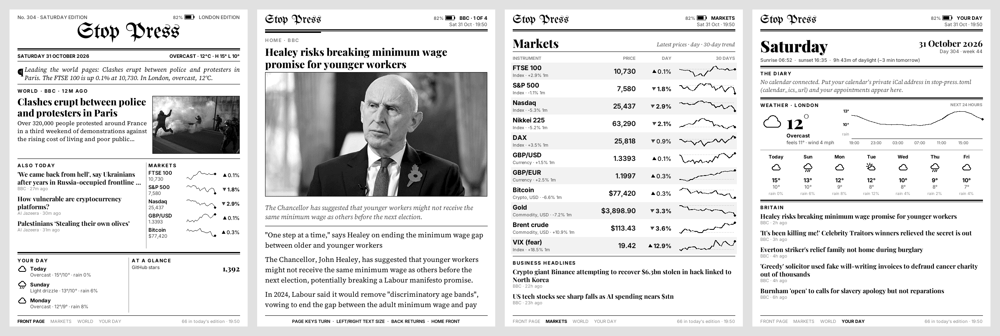
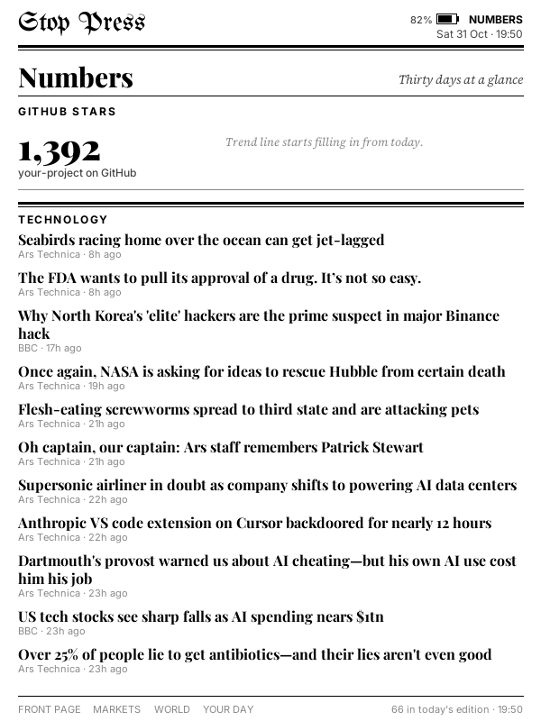

# Stop Press

**A newspaper for your old e-reader.** Stop Press turns a jailbroken Kindle 4 into a broadsheet that updates itself,
and runs in the web browser of most other e-readers, old phones and tablets ([Other devices](#other-devices)).
It has a front page with a lead photo, world news, markets with 30-day sparklines, a weather and diary page, and full
articles with their photos that you turn with the page keys. Each night it also files a proper Kindle "periodical"
edition into your library.



**Why:** old e-readers have perfectly good screens but no longer get updates, so most of them end up in landfill.
Stop Press gives a "dead" Kindle 4 a daily job instead. It started as part of a small computer-donation project
that keeps devices out of the bin.

**Try it now** on your e-reader, phone or computer, no setup:
**[the public demo](https://ca-stop-press-demo.ashybush-ce81b9e0.uksouth.azurecontainerapps.io/)**. Tap a headline to read
it, tap the sides to turn pages. The demo carries GOV.UK news (contains public sector information licensed under the
[Open Government Licence v3.0](https://www.nationalarchives.gov.uk/doc/open-government-licence/version/3/)) and shows
summaries rather than full articles. Your own server can use any feeds you like. Its settings are in `demo/`.

## Two ways to run it

| | In any e-reader's browser | On a jailbroken Kindle 4 |
|---|---|---|
| Devices | Most Kindles (Touch, Paperwhite, Voyage, Oasis, basic), Kobo, Boox, old phones and tablets | Kindle 4 (2011, non-touch). Kindle 5 probably works too, [please test](https://github.com/OPISGUY/stop-press/issues/1) |
| Setup | Run the server, open `/view` and bookmark it. No jailbreak | Run the server, jailbreak, copy a folder over USB |
| Controls | Tap a headline to read it, tap the sides to turn pages | Page keys, 5-way, Home, Back, Menu |
| Battery | Stays awake, so keep it near a charger | Sleeps between hourly refreshes; weeks on a charge |
| Out of Wi-Fi range | Stops updating | Carries on from a saved copy |
| Daily edition in the library | No | Yes |

Want the full version on another model? [The pinned issue](https://github.com/OPISGUY/stop-press/issues/1) ranks
them easiest first, with a checklist for each.

## What it does

The Kindle stays simple: it sends each button press to a small server you run, then draws the 600×800 PNG that comes
back. The server keeps everything else, including what's on screen, what you've read and how far you got. It runs in
one Docker container on a Raspberry Pi, a NAS, an old laptop or any cheap VPS.

- **Readable on e-ink:** set in Source Serif, Playfair Display and Inter, with a blackletter masthead. Photos are
  dithered to the Kindle's 16 greys, so they print like newsprint.
- **Interactive:** the page keys, the 5-way, Home, Back and Menu all work (see [Controls](#controls)). Page turns
  appear almost at once, because the Kindle fetches the likely next screens while you read.
- **Full articles:** every story the paper shows is saved with its full text and in-article photos, so it stays
  readable after it drops off the front page. Ticks mark what you've read, and the index offers "Continue reading".
- **Daily edition:** a real Kindle periodical (`.mobi`, built with Calibre), with sections, an article list and
  adjustable fonts. It downloads hourly and keeps two weeks.
- **Works out of Wi-Fi range:** every hour it downloads the whole paper (sections plus full articles, about 4 MB) as
  a saved copy. If the Wi-Fi drops, the keys carry on through that copy from the page you were on. Home reconnects.
- **Sleeps properly:** after 3 minutes, or a press of the power button, it shows the front page and suspends.
  It wakes every hour to refresh. A charge lasts weeks. Overnight it shows a "gone to press" screen.
- **Boots into the paper** if you want it to (KUAL → Stop Press → Start at boot: on).
- **Markets in depth:** your own watchlist (up to 60 shares, indices, currencies, crypto), paged. Open any of them
  for its own screen: a chart over a day to five years, today's and the 52-week range, volume and its headlines.
  Edit the list from your phone at `/watchlist?t=<token>`: search for anything Yahoo Finance knows and add it.
- **Yours to configure:** masthead, town, any RSS feeds, markets, your calendar, and your own numbers (any JSON URL)
  with trend lines.
- **No accounts, no API keys** for the defaults: Open-Meteo for weather, the Yahoo Finance chart endpoint for markets,
  and public RSS.

| | |
|---|---|
|  |  |

## What you need

- Somewhere to run Docker that your device can reach over Wi-Fi.
- One of these:
  - **Any device with a web browser**, no jailbreak: other Kindles (Touch, Paperwhite, Voyage, Oasis, basic
    Kindles) through their Experimental Browser, Kobos, Boox and other Android e-readers, old phones and tablets.
    See [Other devices](#other-devices). Five minutes to set up.
  - A **Kindle 4** (2011, the non-touch model with a 5-way pad and page keys on both sides) on firmware 4.1.x,
    **jailbroken**, with **KUAL** installed, for the full version: it sleeps between refreshes, lasts weeks on a
    charge, works out of Wi-Fi range and files a daily edition into the library.

## Beginners: download the app

No terminal and no Docker. The desktop app runs the paper on your own computer, with an icon in the tray (the menu
bar on a Mac).

1. Download it from the [Releases page](https://github.com/OPISGUY/stop-press/releases): `StopPress-Windows.exe`
   for Windows, or `StopPress-macOS.zip` for a Mac (unzip it and drag StopPress into Applications). A Linux build,
   `StopPress-Linux`, is there too.
2. Open it. Your web browser opens the settings page: set your town, time zone and, if you like, your calendar.
3. Connect your e-reader. Type in the address the page shows, or scan its QR code. Kindle 4 owners follow
   [section 2](#2-set-up-the-kindle-4) below; other devices are in [Other devices](#other-devices).

Good to know:

- **The app isn't signed,** so your computer warns you the first time. On Windows, click **More info**, then
  **Run anyway**. On a Mac, right-click StopPress and choose **Open**, then **Open** again. You only need this once.
- **The computer must stay on,** on the same Wi-Fi as the device. If it goes to sleep, the paper stops updating. Tick
  **Keep computer awake** in the tray menu while it's plugged in. Tick **Start with my computer** to have it run when
  you log in.
- Windows may ask whether to allow network access the first time. Click **Allow**.
- **The Kindle daily edition (`.mobi`) needs Calibre,** a free e-book program from calibre-ebook.com. Install it and
  the paper uses it automatically. Without Calibre, everything else still works.
- The macOS app is **beta**: it's built automatically, but it hasn't been tried on a Mac yet. Tell us how it goes in
  the [issues](https://github.com/OPISGUY/stop-press/issues).

## 1. Run the server

```bash
git clone https://github.com/OPISGUY/stop-press && cd stop-press
cp stop-press.example.toml stop-press.toml   # set your masthead, town, lat/lon, token
docker compose up -d --build
```

Open `http://<server>:8000/kindle.png` in a browser to see the front page. Other addresses:
`/page/markets.png`, `/page/world.png`, `/page/day.png`, `/page/stats.png`, the edition at `/edition.mobi`, and the
offline copy at `/offline.tar`.

If you set a `token` (do this if the server is reachable from the internet), add `?t=<token>` to every address.
To put it on the internet, run it behind any HTTPS reverse proxy (Caddy, Cloudflare Tunnel, Tailscale Funnel)
or on a container host. On a home network, plain `http://192.168.x.x:8000` is fine.

Without Docker: `cd server && pip install -r requirements.txt && uvicorn paper.app:app --port 8000`. Set
`PAPER_DATA_DIR` to a writable folder. Calibre's `ebook-convert` must be on the PATH for the `.mobi` edition. Without it,
everything else still works.

## 2. Set up the Kindle 4

On any other device, skip this: open `http://<server>:8000/view?t=<token>` in its browser instead (see
[Other devices](#other-devices)).

1. **Jailbreak and install KUAL.** Follow NiLuJe's guide on MobileRead:
   [the K4 jailbreak and snapshots thread](https://www.mobileread.com/forums/showthread.php?t=225030). Install the
   jailbreak, then the Mobileread Kindlet Kit, then KUAL. Also install the **KUAL Helper** and use it to block OTA updates.
   - **2025 gotcha:** the old Kindlet developer keystore expired in April 2025, so KUAL refuses to launch
     ("not made by an authorized developer"). Install NiLuJe's re-signed KUAL 2.7.37 and its 2025 keystore, both
     linked from that thread.
2. **Get the helper binaries** (an ARM HTTP client, a cron calculator and a CA bundle) on your computer:
   ```bash
   sh kindle/fetch-binaries.sh
   ```
3. **Configure:** copy `kindle/stop-press/env.sh.example` to `kindle/stop-press/env.sh` and set `DASH_URL` to your
   server's `/kindle.png` address, plus your schedule and timezone.
4. **Copy to the Kindle** over USB:
   - `kindle/stop-press/` → `/mnt/us/stop-press/` (the `stop-press` folder in the drive's root)
   - `kindle/extensions/stop-press/` → `/mnt/us/extensions/stop-press/`
5. Eject, then **KUAL → Stop Press → Start the paper.**
6. Optional: **KUAL → Stop Press → Start at boot: on** makes the Kindle open the paper by itself about a minute after
   it switches on. This adds a small start-up script to the Kindle's system partition. **Start at boot: off** removes
   it, and a file called `NO_AUTOSTART` in the `stop-press` folder skips it for as long as the file is there.

Press the **keyboard key** to return to the normal Kindle library, and use KUAL → Stop Press to start the paper again.
To recover a stuck device, hold power for about 20 seconds.

## Live mode

If the Kindle is plugged in, it can stay awake and keep the page live instead of updating every hour. Market prices
update in place every few seconds. The markets and stock screens count down to the next opening or closing bell
(New York or London), ticking every second. Nothing ever flashes the whole page.

- **Switch it on or off:** press **Home twice** quickly. A note at the foot of the screen says which mode you're in.
  You can also use **KUAL → Stop Press → Start in live mode (plugged in)** or **Start in paper mode (hourly)**.
- **Power:** it only runs while the Kindle is charging or above 20% battery. Below that it goes back to hourly
  updates and sleeping.
- **Page turns don't flash, in either mode.** Each turn leaves a faint outline of the text it wiped. The server keeps
  count, area by area. Once an area has had about six pages of text wiped through it, the server flashes just that
  area, a couple of seconds after the turn. Quiet areas, like the masthead, never flash. In live mode, the screen
  is also cleaned gently 45 seconds after your last turn, and every 20 minutes, one strip at a time. In paper mode,
  this gentle clean runs just before the Kindle sleeps.

**Live mode needs FBInk**, NiLuJe's tool for drawing part of the screen at a time (GPLv3). Some of NiLuJe's Kindle 4
packages already install it: check for `/usr/bin/fbink` or `/mnt/us/libkh/bin/fbink`. If you don't have it, get the
build for older Kindles (K2, K3, K4 and DX) from NiLuJe's own posts. The [K4 snapshots thread](https://www.mobileread.com/forums/showthread.php?t=225030)
and the [FBInk project](https://github.com/NiLuJe/FBInk) point to them. Copy `fbink` to `/mnt/us/stop-press/fbink`.
We don't bundle it or download it for you: GitHub only has its source code, and we haven't pinned a checksum for
any other download. Without FBInk the paper works as before, with a full flash on page turns, and live mode stays off.

## Reading out of Wi-Fi range

Old Kindles have weak Wi-Fi, so the paper keeps a saved copy. At each hourly refresh the Kindle downloads
`/offline.tar`: the sections and up to 24 full articles, each screen as a PNG, in reading order. When a page can't be
fetched, `paper.sh` switches to that copy. It starts at the page you were on, and the footer says "Saved copy from
14:00".

| Button | In the saved copy |
|---|---|
| Page keys, 5-way left / right / press | next / previous screen |
| 5-way up / down, Back | previous / next story or section |
| Menu | front page |
| Home | try the server again (front page of the saved copy if it's still out of reach) |

The next time it wakes in range, it goes back to the live paper.

## Controls

| Button | On a page | In an article |
|---|---|---|
| Page keys (either side) | next / previous page | turn the page |
| 5-way up / down | move between headlines | turn the page |
| 5-way left / right | previous / next page | smaller / bigger text (4 sizes, remembered) |
| 5-way press | open the article or the market (articles resume where you left off) | back to the page |
| Back | all of today's articles | back to the page |
| Home | front page (twice quickly: live / paper mode) | front page |
| Menu | all of today's articles | all articles |
| Power | sleep (refreshes hourly; power wakes it straight into the paper) | same |
| Keyboard key | back to the normal Kindle library | same |

## AI: what it does and doesn't do

**The paper doesn't need AI.** Every headline, summary and article is the publisher's own text from their RSS feed
and article page, never generated or rewritten.

The only AI feature is optional and **off by default**. It is a two- or three-sentence "editor's note" at the top of the
front page, written from the day's headlines, markets and weather. To turn it on, point `[ai]` in
`stop-press.toml` at any OpenAI-compatible endpoint. That includes a local model on **Ollama** (free, private, works
on a Pi 5 with a small model) as well as OpenAI, OpenRouter, LM Studio and others. The prompt tells the model to use
only the facts it's given. When the note is off, the front page builds a plain sentence from the same facts.

**How it was built:** I wrote it with heavy help from an AI coding assistant (Claude Code). I chose what to build,
tested every change on a real Kindle 4, and debugged the hardware quirks by hand on the device. The code is plain
Python and POSIX shell, short enough to read in an evening, and the comments explain the reasoning. You don't need
an AI tool to run, change or contribute to it.

## Your own numbers

Add `[[stats]]` entries to `stop-press.toml`. Each one takes any URL that returns JSON and the path to a figure in it.
Examples: GitHub stars, app installs, a Home Assistant sensor, a Plausible visitor count. The figures appear on the
**Numbers** page and in the front page's "At a glance" box. The server records one reading a day, so each figure gets
a 30-day trend line. Add `stats` to `rotation` to include the page while the Kindle sleeps.

## How it works

```
Kindle 4 (paper.sh)                         server (FastAPI + Pillow, one container)
  key press ──► GET /ui.png?k=next&b=81 ──►  apply the press to the reader state, render 600×800 greyscale PNG
  eips -g screen.png ◄──────────────────────  (≈30 ms; renders cached; feeds cached and refreshed in the background)
  while you read: GET /ui.png?k=next&peek=1  draw the likely next screens without applying them
  asleep: GET /ui.png?k=auto hourly          the front page (or your rotation)
  hourly: GET /edition.mobi                  Calibre periodical of everything filed today
  hourly: GET /offline.tar                   every screen of the paper as PNGs, for reading out of Wi-Fi range
  while you read: GET /bookpos               which page of the saved copy you're on
```

- `server/paper/pages.py` draws the pages, `ui.py` handles the interactive state and article layout, and
  `sources.py` fetches the feeds, weather and markets. `archive.py` stores the day's articles with full text (via
  trafilatura), `photos.py` dithers photos for e-ink, and `periodical.py` builds the `.mobi`.
- `kindle/stop-press/paper.sh` is the whole device side: a key reader, a power-button watcher, the sleep and wake
  loop, and prefetching.

Lessons from getting the Kindle 4's buttons working, for anyone adapting it:
- `webreaderd` and `browserd` keep running after `framework stop` and grab the page keys, Home, Back and Menu.
  `paper.sh` stops them, and starts them again when you leave for the library.
- The side keys send an `EV_MSC` scan-code event just before the key event. Keep the input device open (`exec 4<dev`,
  then `dd <&4`), because reopening it between reads loses the key.
- The power button never reaches apps, because `powerd` owns it. `paper.sh` watches `/var/log/messages` for powerd's
  `pbpress` line instead.
- There's no `setsid` or `nohup` on the K4. `(trap '' HUP; exec sh paper.sh) &` survives KUAL closing.
- BusyBox 1.7 ash's `read` fails when a signal arrives, so the event loop retries instead of exiting.

## Other devices

**In a web browser (no jailbreak).** Open `http://<server>:8000/view?t=<token>` in the device's browser and
bookmark it. The page fills the screen with the paper and sends your taps to the server:

| Tap | On a page | In an article |
|---|---|---|
| A headline | open the article | |
| Right two-thirds | next page | next page |
| Left third | previous page | previous page |
| Top strip | all of today's articles | back to the page |

Arrow keys, Page Up/Down, Enter and Escape work too, for devices with keys and for desktop browsers. Left alone
for 15 minutes, it goes back to a fresh front page.

Where to find the browser:
- **Kindle Touch, Paperwhite, Voyage, Oasis and basic touch Kindles:** the Experimental Browser (Menu → Experimental
  Browser on older firmware, or the "Browser" item on newer). The Kindle Keyboard and Kindle 4 have one too.
- **Kobo:** Settings → Beta features → Web browser.
- **Boox, other Android e-readers, old phones and tablets:** any browser. On Android, "Add to home screen" makes it
  open full screen.

What you don't get in the browser: the device won't sleep between refreshes, so keep it on a charger or expect it
to last a day or two. The screensaver may also come on, and there's no saved copy for when the Wi-Fi drops. Pages
are drawn at 600×800 and scaled to fit, so on a large screen they're a little soft.

Tested at phone size in a desktop browser. If you try it on an e-reader, please say how it went in the
[device issue](https://github.com/OPISGUY/stop-press/issues/1), especially if something didn't work.

**Native ports.** The full version (sleeping between refreshes, the saved copy, the daily edition) needs a device
script like `kindle/stop-press/paper.sh`. It's written for the Kindle 4's keys. The plan for other models, and
how to help, is in [the pinned issue](https://github.com/OPISGUY/stop-press/issues/1).

## Credits

- [kindle-dash](https://github.com/pascalw/kindle-dash) by Pascal Widdershoven (MIT) supplied the original
  sleep/wake idea and the `xh` and `next-wakeup` ARM binaries that `fetch-binaries.sh` downloads.
- NiLuJe and the MobileRead community for the jailbreak, KUAL, USBNetwork and FBInk (which live mode uses).
- Fonts under the SIL Open Font License: Source Serif 4, Playfair Display, Inter, UnifrakturMaguntia (licences in
  `server/fonts/`).
- Weather by [Open-Meteo](https://open-meteo.com) (CC BY 4.0). News, and the photos in the screenshots, belong to
  their publishers. Stop Press fetches them for your personal reading, like any feed reader. Please don't run it as a
  public service that republishes other people's articles.

## License

MIT. See [LICENSE](LICENSE).
